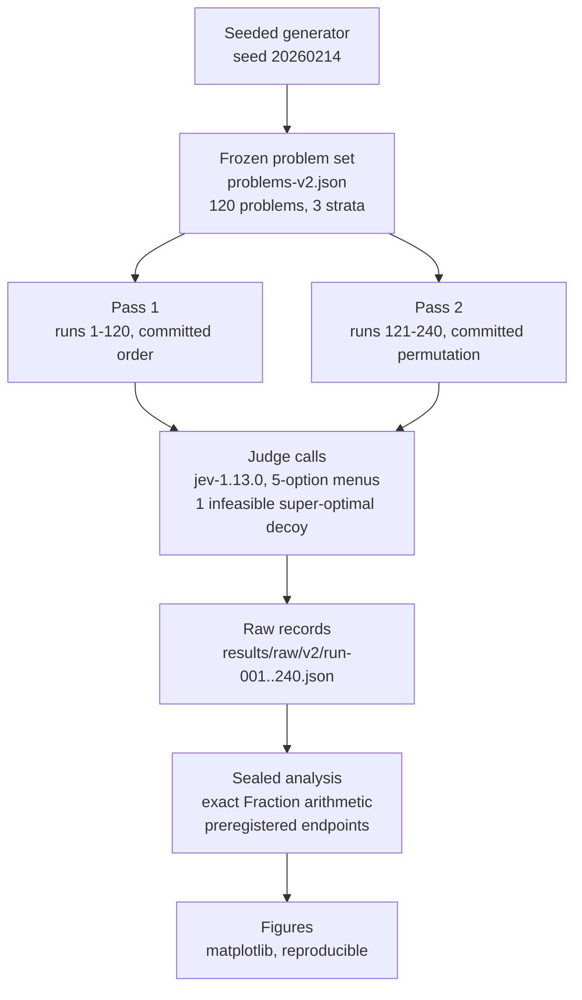
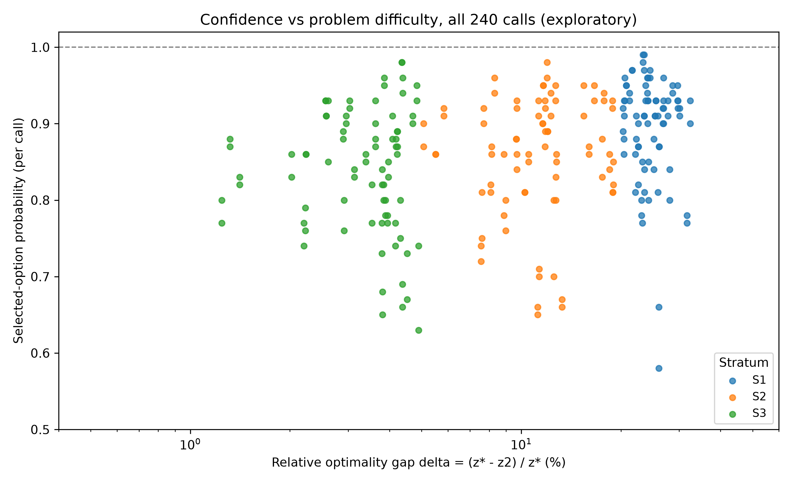
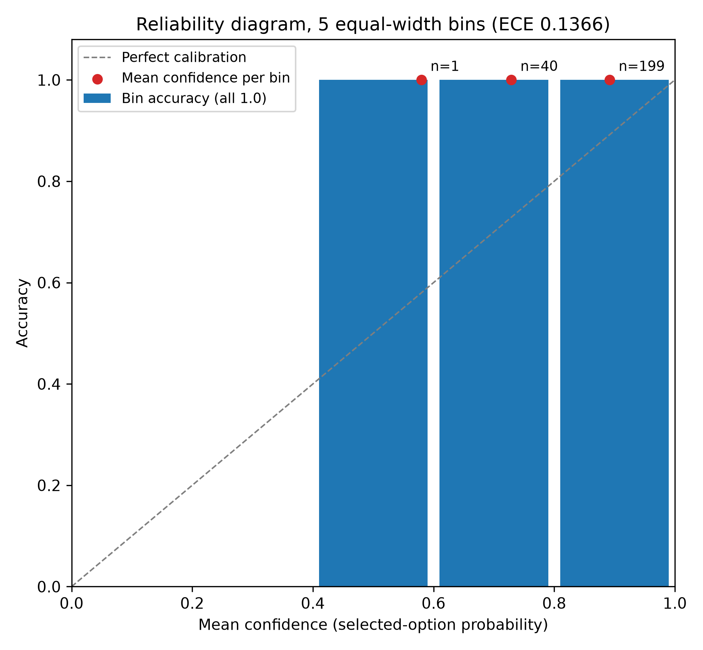

<div align="center">

# Judge Enumeration Exhibit

[](https://doi.org/10.5281/zenodo.23307259)
[](LICENSE)
[](results/v2.md)

</div>

Can a typed probabilistic judge discriminate the optimal candidate from near-optimal and infeasible decoys in small linear-program menus, and are its answers stable across repeated calls?

A pre-registered exhibit in two phases. The v1.0.0 stability phase probed run-to-run stability on 60 calls; the v2.0.0 discrimination phase froze a 120-problem set (40/40/40 strata by relative optimality gap) before any call, ran 120 problems x 2 passes at model pin `jev-1.13.0` under a sealed reading criterion, and analyzed against preregistered endpoints with exact Fraction arithmetic. The judge answered every problem correctly in both passes: the instrument saturates at this difficulty, so the strata do not discriminate. Conclusion: [docs/conclusion.md](docs/conclusion.md).



*Figure 1: The v2.0.0 pipeline. The seeded generator freezes the problem set before any call; two judge passes cover each problem twice in different orders; the sealed analysis reads the raw records against the oracle and computes the preregistered endpoints; the figures derive from the same raw records.*

## Status

**120/120 problems answered correctly in both passes: per-stratum both-call agreement 40/40 in every stratum with Wilson 95% CI [0.912, 1.000], prune failures 0/240, disagreement 0/120, Brier 0.0251, ECE 0.1366, position-bias flat at 1.000, Fisher exact S1 vs S3 p = 1.0.** The ceiling is a property of the instrument, not a success metric of the judge: perfect discrimination at a 1/5 chance rate means the frozen menus are too easy for `jev-1.13.0`, so the task fails to discriminate between strata and the p = 1.0 is a ceiling artifact, not evidence of equal stratum difficulty. Full interpretation: [results/v2.md](results/v2.md). Exhibit conclusion: [docs/conclusion.md](docs/conclusion.md).

*Table 1: Phases of the exhibit.*

| Phase | Question | Runs | Status | Findings |
| --- | --- | --- | --- | --- |
| [v1.0.0 stability](preregistration.md) | Run-to-run stability on identical states | 60 | complete | stable at the probed scale ([results/raw/](results/raw/)) |
| [v2.0.0 discrimination](preregistration-v2.0.md) | Discrimination of optimal vs near-optimal vs infeasible, per stratum | 240 (120 x 2 passes) | complete | ceiling; [results/v2.md](results/v2.md) |

*Table 2: v2.0.0 endpoint summary per stratum (sealed analysis, `experiments/judge-enumeration-v2/endpoints.json`).*

| Endpoint | S1 (delta >= 20%) | S2 (5% <= delta < 20%) | S3 (0.5% <= delta < 5%) | Overall |
| --- | --- | --- | --- | --- |
| Both-call agreement (primary) | 40/40, CI [0.912, 1.000] | 40/40, CI [0.912, 1.000] | 40/40, CI [0.912, 1.000] | 120/120, CI [0.969, 1.000] |
| Prune failure | 0/40 | 0/40 | 0/40 | 0/240 |
| Per-problem disagreement | 0/40 | 0/40 | 0/40 | 0/120 |

Fisher exact S1 vs S3 (two-sided, pre-specified): p = 1.0. Brier score on the selected-option probability: 0.0251. ECE, 5 equal-width bins: 0.1366. Position-bias check: agreement 1.000 and prune failure 0.000 at every optimal-candidate position (n=48 calls per position).

## Structure

- `preregistration.md`, `preregistration-v2.0.md`: the phase preregistrations; v2.0 fixes the frozen problem set, model pin, sealed reading criterion (section d), and endpoints (section e).
- `generate_problems.py`: the seeded generator; `problems-v2.json` is its committed frozen output (sha256 in the v2 preregistration).
- `oracle-v2.json`: analysis-side oracle values per problem (optimal id, decoy id, stratum).
- `run_judge.py`: the judge runner; executes the two passes and writes raw records, refusing to overwrite or to accept fallbacks.
- `results/raw/v2/run-001..240.json`: verbatim request and response per call; `results/calls-v2.jsonl`: the append-only call log.
- `experiments/judge-enumeration-v2/`: sealed analysis (`analyze_v2.py`, `endpoints.json`, `analysis.json`, `findings.md`); every endpoint is computed with exact Fraction arithmetic from the raw records.
- `results/v2.md`: prose interpretation of every section (e) endpoint.
- `figures/`: matplotlib figures, one Python script plus one PNG per figure, deriving only from the raw records and the oracle; regenerate with `uv run --with matplotlib python figures/<script>.py`.
- `docs/conclusion.md`: what the two phases jointly establish and what a v2.1 would need.
- [METHODOLOGY.md](METHODOLOGY.md): the shared experimental design contract; [DATA_DICTIONARY.md](DATA_DICTIONARY.md): schemas for the analysis records and v2 artifacts.
- [CITATION.cff](CITATION.cff): citation metadata; DOI minted at v2.0.0.

## Figures

All figures derive only from the raw v2 run records plus the committed oracle, reusing the sealed-criterion code in `experiments/judge-enumeration-v2/analyze_v2.py`.



*Figure 2: Exploratory. Per-call selected-option probability against the committed relative optimality gap (log scale), all 240 calls, colored by stratum. Selections are correct everywhere, so the endpoint cannot vary; confidence does. No monotone confidence-versus-difficulty trend is claimed or tested.*



*Figure 3: Reliability diagram over the 5 equal-width bins behind the ECE of 0.1366. All 240 calls fall in the top three bins; bin accuracy is 1.0 everywhere, so each bin's error is exactly its confidence shortfall.*

## Reproduction

```sh
uv run python validate_schema.py
python3 -m unittest -v
python3 experiments/judge-enumeration-v2/analyze_v2.py
uv run --with matplotlib python figures/fig1-confidence-vs-gap.py
uv run --with matplotlib python figures/fig2-calibration.py
```

## License

Apache-2.0.
