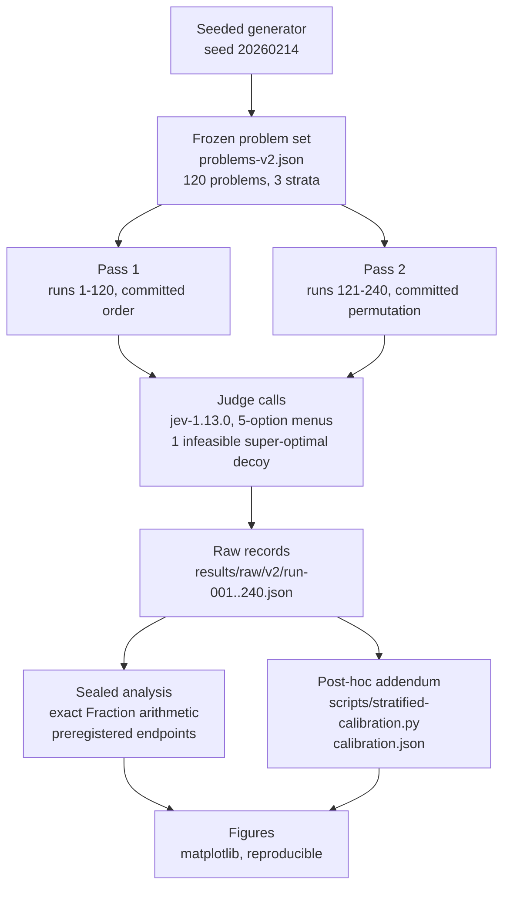
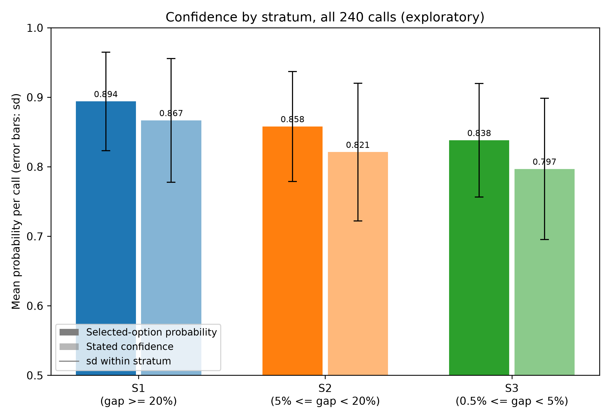

<div align="center">

# Judge Enumeration Exhibit

[](https://doi.org/10.5281/zenodo.23307259)
[](LICENSE)
[](results/v2.md)

</div>

## Abstract

Can a typed probabilistic judge discriminate the optimal candidate from near-optimal and infeasible decoys in small linear-program menus, and are its answers stable across repeated calls? We present two pre-registered phases of a typed probabilistic judge on a frozen 3-variable integer linear-program task. The v1.0.0 stability phase probed run-to-run stability on 60 calls. The v2.0.0 discrimination phase froze a 120-problem set (40/40/40 strata by relative optimality gap) before any call, ran 120 problems x 2 passes at model pin `jev-1.13.0` under a sealed reading criterion, and analyzed preregistered endpoints with exact Fraction arithmetic. The judge answered every problem correctly in both passes: per-stratum both-call agreement is 40/40 with Wilson 95% CI [0.912, 1.000], the infeasible super-optimal decoy is never selected (0/240), Brier score is 0.0251, and ECE is 0.1366. The instrument saturates at this difficulty, so the strata do not discriminate; the Fisher exact S1-versus-S3 test (p = 1.0) is a ceiling artifact. A clearly labeled post-hoc addendum then surfaces a graded structure the pooled framing missed: mean selected-option probability descends monotonically with difficulty (0.894, 0.858, 0.838 across strata; S1 versus S3 Welch t = 4.63) even though selections never flip. The gradient is stratum-level rather than instance-level, and pass-to-pass probabilities drift (mean |delta| = 0.0245) while the argmax stays fixed. The exhibit concludes at v2.0.0 with the ceiling as an instrument property and the headroom to a v2.1 quantified.

## Status

**120/120 problems answered correctly in both passes; per-stratum endpoints in Table 2.** The ceiling is a property of the instrument, not a success metric of the judge: perfect discrimination at a 1/5 chance rate means the frozen menus are too easy for `jev-1.13.0`, so the task fails to discriminate between strata and the p = 1.0 is a ceiling artifact, not evidence of equal stratum difficulty. A post-hoc stratified-calibration addendum documents a graded confidence gradient in the same raw records; see [findings-calibration.md](experiments/judge-enumeration-v2/findings-calibration.md). Full interpretation: [results/v2.md](results/v2.md). Exhibit conclusion: [docs/conclusion.md](docs/conclusion.md).

## Phases

*Table 1: Phases of the exhibit.*

| Phase | Question | Runs | Status | Findings |
| --- | --- | --- | --- | --- |
| [v1.0.0 stability](preregistration.md) | Run-to-run stability on identical states | 60 | complete | stable at the probed scale ([results/raw/](results/raw/)) |
| [v2.0.0 discrimination](preregistration-v2.0.md) | Discrimination of optimal vs near-optimal vs infeasible, per stratum | 240 (120 x 2 passes) | complete | ceiling; [results/v2.md](results/v2.md) |

*Table 2: v2.0.0 endpoint summary per stratum (sealed analysis, `experiments/judge-enumeration-v2/endpoints.json`).*

| Endpoint | S1 (delta >= 20%) | S2 (5% <= delta < 20%) | S3 (0.5% <= delta < 5%) | Overall |
| --- | --- | --- | --- | --- |
| Both-call agreement (primary) | 40/40, CI [0.912, 1.000] | 40/40, CI [0.912, 1.000] | 40/40, CI [0.912, 1.000] | 120/120, CI [0.969, 1.000] |
| Prune failure | 0/40 | 0/40 | 0/40 | 0/240 |
| Per-problem disagreement | 0/40 | 0/40 | 0/40 | 0/120 |

Fisher exact S1 vs S3 (two-sided, pre-specified): p = 1.0. Brier score on the selected-option probability: 0.0251. ECE, 5 equal-width bins: 0.1366. Position-bias check: agreement 1.000 and prune failure 0.000 at every optimal-candidate position (n=48 calls per position).

*Table 3: Post-hoc stratified-calibration summary per stratum (80 calls each; `experiments/judge-enumeration-v2/calibration.json`, not preregistered).*

| Measure | S1 (gap >= 20%) | S2 (5% <= gap < 20%) | S3 (0.5% <= gap < 5%) |
| --- | --- | --- | --- |
| Selected-option probability, mean (sd) | 0.894 (0.071) | 0.858 (0.079) | 0.838 (0.082) |
| Stated confidence, mean (sd) | 0.867 (0.089) | 0.821 (0.099) | 0.797 (0.102) |
| Runner-up probability, mean | 0.053 | 0.069 | 0.082 |
| Mean entropy (bits) | 0.625 | 0.784 | 0.859 |
| Infeasible decoy probability, mean | 0.015 | 0.020 | 0.017 |

S1 versus S3 Welch contrast on stated confidence: 0.070, SE 0.015, t = 4.63. The gradient is stratum-level, not instance-level: within-stratum correlation of relative gap with selected probability is approximately zero (-0.107, +0.091, -0.059), while the pooled r = 0.273 is driven by the stratum means.

## Pipeline



*Figure 1: The v2.0.0 pipeline. The seeded generator freezes the problem set before any call; two judge passes cover each problem twice in different orders; the sealed analysis reads the raw records against the oracle and computes the preregistered endpoints; the post-hoc addendum re-derives stratified confidence statistics from the same raw records with no new judge calls; the figures derive from the same sources.*

## Figures

All figures derive only from the raw v2 run records plus the committed oracle, reusing the sealed-criterion code in `experiments/judge-enumeration-v2/analyze_v2.py`. The reliability diagram behind the ECE remains in [results/v2.md](results/v2.md).


*Figure 2: Exploratory. Per-call selected-option probability against the committed relative optimality gap (log scale), all 240 calls, colored by stratum. Selections are correct everywhere, so the endpoint cannot vary; confidence does. No monotone confidence-versus-difficulty trend is claimed or tested.*



*Figure 3: Post-hoc (not preregistered). Mean selected-option probability (solid) and stated confidence (faded) per stratum over 80 calls each, with within-stratum sd error bars. Both measures descend monotonically from S1 to S3 although the selected option never flips; see [findings-calibration.md](experiments/judge-enumeration-v2/findings-calibration.md).*

## Structure

- `preregistration.md`, `preregistration-v2.0.md`: the phase preregistrations; v2.0 fixes the frozen problem set, model pin, sealed reading criterion (section d), and endpoints (section e).
- `generate_problems.py`: the seeded generator; `problems-v2.json` is its committed frozen output (sha256 in the v2 preregistration).
- `oracle-v2.json`: analysis-side oracle values per problem (optimal id, decoy id, stratum).
- `run_judge.py`: the judge runner; executes the two passes and writes raw records, refusing to overwrite or to accept fallbacks.
- `results/raw/v2/run-001..240.json`: verbatim request and response per call; `results/calls-v2.jsonl`: the append-only call log.
- `experiments/judge-enumeration-v2/`: sealed analysis (`analyze_v2.py`, `endpoints.json`, `analysis.json`, `findings.md`) plus the post-hoc addendum (`calibration.json`, `findings-calibration.md`); every sealed endpoint is computed with exact Fraction arithmetic from the raw records, and the addendum re-derives its numbers the same way via `scripts/stratified-calibration.py`.
- `results/v2.md`: prose interpretation of every section (e) endpoint.
- `figures/`: matplotlib figures, one Python script plus one PNG per figure, deriving only from the raw records and the oracle; regenerate with `uv run --with matplotlib python figures/<script>.py`.
- `docs/conclusion.md`: what the two phases jointly establish and what a v2.1 would need.
- [METHODOLOGY.md](METHODOLOGY.md): the shared experimental design contract; [DATA_DICTIONARY.md](DATA_DICTIONARY.md): schemas for the analysis records and v2 artifacts.
- [CITATION.cff](CITATION.cff): citation metadata; DOI minted at v2.0.0.

## Reproduction

```sh
uv run python validate_schema.py
python3 -m unittest -v
python3 experiments/judge-enumeration-v2/analyze_v2.py
python3 scripts/stratified-calibration.py
uv run --with matplotlib python figures/fig1-confidence-vs-gap.py
uv run --with matplotlib python figures/fig3-stratified-confidence.py
```

## License

Apache-2.0.
